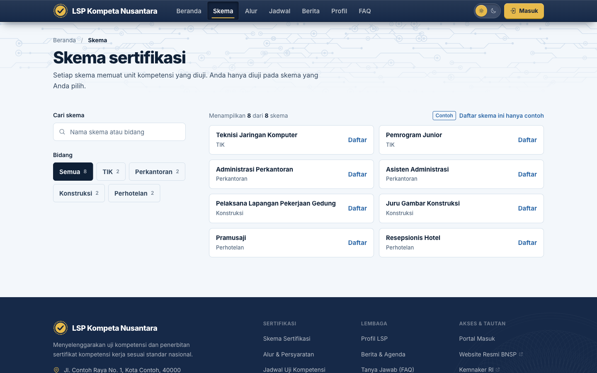
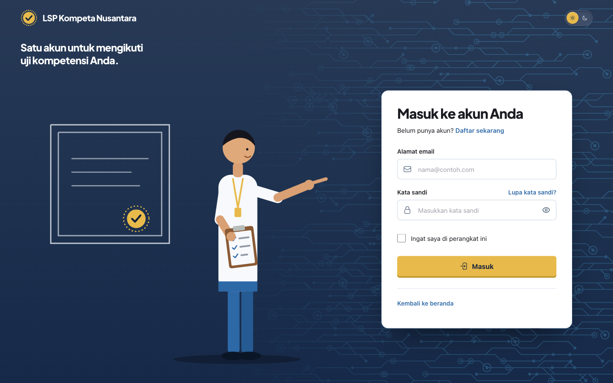
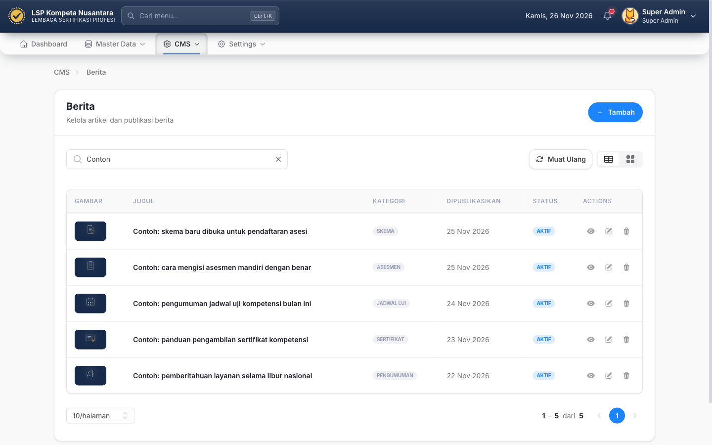

# Laravel Livewire CMS Platform

> **v3.3.0** — Laravel + Livewire CMS with role-based access control and a public portal for a professional certification body (LSP): scheme and schedule pages, certification flow, news and FAQ, plus redesigned sign-in screens. The admin panel includes user import from Excel/CSV and dashboard charts. The look is built from the LSP logo colours (brand blue, sky blue and one gold accent on a deep navy ground). Content is backed by a reproducible, clearly labelled sample-data seeder.

## 📸 Screenshots

All images are 1440 × 900 (the phone view is 390 × 844) and use the sample data from `WebsiteContentSeeder`.

### Public website

| Home (hero) |
|---|
|  |

| Schemes page, light theme | Schemes page, dark theme |
|---|---|
|  |  |

| Phone (390 px) |
|---|
|  |

### Sign-in and admin panel

| Login | Dashboard |
|---|---|
|  |  |

| CMS — News |
|---|
|  |

## 🚀 Tech Stack

| Category | Technology |
|---|---|
| **Language** | PHP 8.2+ |
| **Framework** | Laravel 13 |
| **Reactive UI** | Livewire 4 (full-page components) |
| **CSS Framework** | Tailwind CSS 4 (Vite plugin) |
| **JavaScript** | Alpine.js 3 (npm bundle) + `@alpinejs/collapse` |
| **Admin UI** | Livewire Flux 2 + Filament Forms 5 (form schemas only) + Flowbite (CDN) |
| **Charts** | Highcharts 13 |
| **Typeface** | Inter (admin panel, public site and sign-in screens) |
| **Database** | SQLite (configurable → MySQL / PostgreSQL) |
| **Queue** | Database driver |
| **Email** | SMTP with queued notifications |
| **Build Tool** | Vite 8 (four entry points: admin CSS/JS and website CSS/JS) |
| **Tests** | PHPUnit 13 |

---

## ✨ Features

### 🔐 Authentication & Security

- Full auth flow: Login, Register, Forgot Password, Reset Password, Email Verification
- **Form card over a full navy background** — the form sits in a card on the right, over a faint static circuit motif; on the left is an original illustration (an assessor beside a framed certificate, drawn for this project, not stock art). The same screen is used for every auth page
- **Email verification links** are signed and expire after 3 days (`AUTH_VERIFICATION_EXPIRE`, in minutes); a hand-built or expired link verifies nothing
- **Temporary passwords** — accounts created by an administrator get an 8-character password (upper case, lower case and digits, no look-alikes) in the verification email. The verification page and every admin page remind the user to change it until they do. Resending the verification issues a new one
- **Mail retries** — verification and password reset emails are retried 3 times, after 10, 30 and 60 seconds
- **Theme switch** — one button with a sun and a moon icon; the gold knob slides to the active theme
- Queued email notifications (Mailtrap-ready)
- Standardized password validation (NIST/OWASP) with real-time strength indicator
- Rate limiting: auth routes 10 req/min, public website 60 req/min
- Role-based access control (RBAC)

### 🌐 Public Website (professional certification body)

A public portal themed for a professional certification body (LSP), with its own design system (`website.css` / `website.js`), entirely separate from the admin panel. Anything that looks like data (schemes, schedule, FAQ, sample articles) is clearly labelled as a sample, and no statistics, testimonials, partner logos or compliance claims are shown.

- **Home** — hero (headline, a search box and field tags that open `/skema`, a brown sample certificate, three quick-link tiles) → a summary of six schemes with a "see all" button → certification flow (five numbered steps, then the Competent / Not Yet Competent decision) → the next five exam dates with a "see all" button → highlights (CMS carousel) → latest news → FAQ (one card per question) → closing call to action
- **Technology motifs** — circuit traces behind the inner page headers, a triangular lattice behind the schedule, FAQ and closing sections; single colour and faint so text stays readable
- **Signed-in visitors** see "Dashboard" instead of "Masuk" in the navigation and footer
- **Schemes page (`/skema`)** — the full list: search, field filter with counts, two compact columns and a "show more" step, so it stays short with 20+ schemes. Reads `?q=` and `?bidang=` from the hero
- **Schedule page (`/jadwal`)** — the full exam schedule with search, a registration filter and pagination
- **First screen fits the viewport** — on large screens the hero is as tall as the window minus the header, with the quick links resting on the bottom edge; on short windows the field tags are hidden and spacing tightens, so nothing is cut off on first load
- **Certificate illustration** — the three unit ticks draw in one after another and the KOMPETEN seal lands, on a looping 7 s cycle. The certificate itself stays still, and motion stops under `prefers-reduced-motion`
- **Dark navigation bar** — a key-shaped marker slides to the item you point at: raised while it moves, pressed in with a gold underline on the current page. One theme-switch button; the mobile menu opens as a full-width panel
- **News** — list (lead story plus cards with a category icon), categories sidebar with icons, article page with related news, and a dedicated pagination view (`views/vendor/pagination/website.blade.php`)
- **About Page** — company description, official channels, Google Maps embed
- **Dark/Light Mode** — persisted to localStorage, with no white flash on navigation
- **SEO** — meta tags, Open Graph, Twitter Cards
- **Responsive** — mobile-first, checked at 360 px, 390 px and 1440 px

**Design tokens** (sampled from the LSP logo; see [`design.md`](design.md) for the full system):

| Token | Value | Use |
|---|---|---|
| `brand` | `#2D68A7` | Logo blue: links, stamp ink |
| `sky` | `#4BA5DA` | Logo sky blue: links and focus on dark |
| `navy` / `navy-2` | `#162948` / `#273955` | Hero, footer, navigation bar, dark bands |
| `gold` | `#E7BA4B` | The single accent: primary actions, seal. Text on gold is `#14213A` |

Gold is never used as text on a light surface (contrast too low); `brand` is used there instead. All text pairs were checked against WCAG AA.

**Content Seeding**: `WebsiteContentSeeder` seeds a fictional LSP ("LSP Kompeta Nusantara", contact details on reserved `.example` domains), news categories and articles (titles start with "Contoh"), and three carousel slides. It is idempotent (matched on natural keys) and generates its own illustration SVGs, so `migrate:fresh --seed` is fully reproducible on a clean clone. Replace the sample content from the admin panel before going live.

### 📰 CMS (Content Management)

- **News** — Create/edit/publish articles, rich text editor, auto-slug, excerpt generation
- **News Categories** — Organize articles, filter by category on public website
- **Carousels** — Homepage slider management, drag-and-drop ordering
- **About Us** — Company profile, contact info, social links, map coordinates, logo

### ⚙️ Settings

- **System Settings** — Favicon, SEO metadata, Google Analytics
- **Log Viewer** — View/filter/search Laravel logs (super-admin only, Opcodes Log Viewer)
- **Job Monitor** — View queued jobs
- **Menu icons** — pick a menu's icon from a pop-up Heroicons catalog

### 👥 Master Data

- **User Management** — CRUD, auto-generated passwords, avatar, role assignment, filters
- **User Import** — download an Excel template (with example rows and notes), upload `.xlsx` or `.csv`, check a per-row preview, then import only the valid rows (up to 200). Only the `nama`, `email` and `role` columns are read. Imported accounts are active and receive a verification email with a temporary password
- **Role Management** — Create roles, assign menu access per role
- **Menu Management** — Dynamic menu builder, drag-and-drop ordering, Heroicon support

### 📊 Dashboard

- Donut chart of account status and bar chart of users per role, side by side
- Key metrics cards
- Charts are reusable components (`<x-ui.pie-chart>`, `<x-ui.bar-chart>`) with a screen reader table, redrawn when the theme changes

### 🎨 Admin UI/UX

- **Top navigation** instead of a sidebar: a navy header (logo, menu search with Ctrl/Cmd+K, date, notifications, profile) above a menu bar built from the Menu master — role-aware, with icons from the master, dropdown groups and a "More" overflow for items that do not fit. On small screens a hamburger opens a vertical drawer
- Depth: the header uses the same navy gradient as the public navigation bar, with a lit top edge; the active menu item is a recessed tab with a short underline
- Dark mode throughout admin panel
- Toast notifications (success, danger, warning, info)
- Reusable components: modals, tables, cards, badges, pagination, empty states, **autocomplete select** (`<x-ui.select>` — single/multiple + searchable)
- Real-time password strength indicator
- Filter modals with URL-persisted state and active-filter badge counters

### 🔔 In-App Notifications

- Custom notification model (role-based routing: `from_role_id`, `to_role_id`)
- Notification bell with unread count
- Notification inbox with read/unread filters

---

## 📦 Installation

### Prerequisites

- PHP 8.2+
- Composer
- Node.js 20.19+ (or 22.12+) & NPM — required by Vite 8
- SQLite (or MySQL/PostgreSQL)

### Steps

```bash
# 1. Clone & install
git clone <repo>
cd <repo>
composer install
npm install

# 2. Environment
cp .env.example .env
php artisan key:generate
touch database/database.sqlite
php artisan storage:link

# 3. Configure .env
APP_URL=http://127.0.0.1:8000   # must match the address you open: email links are built from it
AUTH_VERIFICATION_EXPIRE=4320   # optional, minutes (default 3 days)
DB_CONNECTION=sqlite
MAIL_MAILER=smtp
MAIL_HOST=your-smtp-host
MAIL_PORT=587
MAIL_USERNAME=your-username
MAIL_PASSWORD=your-password
MAIL_FROM_ADDRESS=noreply@example.com

# 4. Database
php artisan migrate:fresh --seed

# 5. Build assets
npm run build      # production
# OR
npm run dev        # development (HMR)
```

Upgrading an existing installation from 3.2.x:

```bash
composer install && npm install
php artisan migrate          # adds users.must_change_password
npm run build
php artisan queue:restart    # workers must reload the new code, then start them again
```

Verification links sent before 3.3.0 no longer work; resend them from the user list.

### Default Credentials

| Role | Email | Password |
|---|---|---|
| Super Admin | `superadmin@example.com` | `password` |

### Run (Development)

```bash
# All-in-one (recommended)
composer dev

# Or individually:
php artisan serve          # Terminal 1
npm run dev                # Terminal 2
php artisan queue:listen   # Terminal 3
php artisan pail           # Terminal 4 (logs)
```

Emails are queued, so nothing is sent without a queue worker. Notes for local development:

- On macOS, port 5000 is used by AirPlay Receiver and `localhost:5000` reaches it instead of the app. Use `127.0.0.1`, or another port.
- The Mailtrap sandbox rejects emails sent in quick succession. Retries cover small batches; a large import may still leave failed jobs.

### Tests

```bash
php artisan test
```

---

## 📁 Project Structure

```
app/
├── Actions/
│   └── Website/           # Public page action classes (ShowHomePage, ShowNewsList, ...)
├── Forms/                 # Filament form schemas
├── Http/Middleware/       # CheckMenuAccess, SecurityHeaders
├── Livewire/
│   ├── Auth/              # Authentication components
│   ├── Concerns/          # Shared traits (WithNotifications, WithRateLimiting, ...)
│   ├── Layout/            # NotificationBell, NotificationIndex (Sidebar is unused: navigation is a top bar)
│   ├── Settings/          # System settings, Logs, Jobs
│   └── [Feature]/         # Feature-specific CRUD components
├── Models/                # 10 Eloquent models (all with UUID + soft deletes)
├── Repositories/          # Repository pattern (Interface → Implementation)
├── Services/              # MenuService, UserImportService
└── Support/               # SampleContent (sample schemes and schedule), HeroiconCatalog

public/images/
└── guilloche.svg          # Security-print rosette, used only as a CSS mask

resources/
├── css/
│   ├── app.css            # Admin styles (Metronic/Flux/Filament)
│   └── website.css        # Website styles (LSP design system, separate from admin)
├── js/
│   ├── app.js             # Admin JS (Highcharts, Flowbite)
│   └── website.js         # Website JS (Alpine.js + collapse; interactions are inline in the views)
└── views/
    ├── components/
    │   ├── layouts/       # app.blade.php (admin, top navigation), auth.blade.php (form card on navy)
    │   └── ui/            # Reusable UI components
    ├── livewire/          # Livewire blade views
    ├── layouts/           # website.blade.php
    ├── partials/          # Shared partials (meta, favicon, theme scripts, admin top nav, ...)
    └── website/           # Public pages + partials (nav, hero, skema, alur, jadwal, sorotan, faq, cta, footer, ...)

routes/modules/
├── auth.php               # Authentication routes
├── cms.php                # CMS routes
├── master_data.php        # User/Role/Menu routes
├── settings.php           # Settings routes
└── website.php            # Public routes (rate limited)

docs/screenshots/          # Images used by this README
design.md                  # Design system (colours, type, components) for admin, site and auth
claude.md                  # Project conventions for AI assistants
```

---

## 🛠️ Key Patterns

### Adding a New CMS Module

1. Migration → Model (`HasUuid`, `SoftDeletes`) → Repository Interface → Implementation → Binding
2. Form schema in `app/Forms/` → Livewire component (inject repo via `boot()`) → Blade view
3. Route in `routes/modules/` → Menu seeder entry

### Protecting Admin Routes

```php
Route::middleware(['auth', 'verified', 'menu.access'])->group(function () {
    Route::get('/your-route', YourComponent::class)->name('your.route');
});
```

### Using the Website Partials

Website partials live in `resources/views/website/partials/`. The reusable ones:

```blade
{{-- News card: variant is 'card' (default), 'lead' or 'row' --}}
@include('website.partials.news-card', ['item' => $newsItem, 'variant' => 'lead'])

{{-- Inner page header (the only <h1> on the page) --}}
@include('website.partials.page-header', [
    'title'      => 'Page title',
    'breadcrumb' => 'Breadcrumb label',
    'subtitle'   => 'Optional one-line description.',
])

{{-- Seal + organisation name; textClass overrides the name's colour and size --}}
@include('website.partials.logo', ['textClass' => 'font-extrabold text-lg text-white'])

{{-- Social icons; pass dark => true when sitting on a dark ground --}}
@include('website.partials.social-links', ['dark' => true])
```

Schemes and schedule are sample content with a visible "Contoh" label, read from one place (`App\Support\SampleContent` and `config/sample-schemes.php`) until real models exist. The home page shows a summary; the full lists live on `/skema` and `/jadwal`.

### Admin UI components

```blade
<x-ui.bar-chart title="Users per role" :items="$rows" unit="users" label-heading="Role" />
<x-ui.pie-chart title="Account status" :items="$rows" unit="users" label-heading="Status" />
<x-ui.button.import wire:click="$dispatch('open-user-import')" />
```

`items` is a list of `['label' => string, 'value' => int]`; the donut also accepts a `color` per item. Row action buttons live in `components/ui/button/` and share one anatomy (`flux:tooltip` plus a `mini` icon).

Home-page sections: `hero`, `skema` (summary), `alur`, `jadwal` (summary), `sorotan` (carousel), `faq`, `cta`. The full lists are `skema-list` (`/skema`) and `jadwal-list` (`/jadwal`). `alur` and `faq` hold static sample content in the view; `sorotan` and the news and profile blocks come from the CMS.

---

## 🔧 Artisan Commands

```bash
php artisan optimize:clear     # Clear all caches
php artisan queue:work         # Run queue worker
php artisan queue:retry all    # Retry failed jobs (not verification mails that were resent since)
php artisan queue:flush        # Delete failed jobs
php artisan migrate:fresh --seed  # Reset database
```

---

## 📋 Changelog

### v3.3.0
- **Schemes and schedule pages**: `/skema` and `/jadwal` hold the full lists with search and filters; the home page shows a summary.
- **Public site visuals**: brown certificate illustration, circuit motif behind page headers, lattice behind home sections, FAQ as cards, category icons on news, and "Dashboard" instead of "Masuk" for signed-in visitors.
- **User import** from Excel/CSV with a template, a per-row preview and a verification email per account.
- **Temporary passwords** (8 characters) with a reminder to change them after verification and sign-in; resending includes a new one.
- **Security fix**: verification links are now actually checked. Before this, any account could be verified by building the URL by hand, and links never expired. They now expire after 3 days.
- **Mail**: 3 retries with growing pauses; the verification email no longer shows IP address or location.
- **Admin**: navy header matching the public site, users-per-role chart, reusable chart components, orange filter button, menu icon picker.
- **Fixes**: invisible link on the register page on hover, chart labels unreadable after switching to dark mode, footer overlapping the news list.

### v3.2.1
- **Fix**: the public header fits on phones, with a single theme switch. README and screenshots refreshed.

### v3.2.0
- **Colours from the LSP logo**: the public site, sign-in screens and admin header now share one palette sampled from the logo (brand blue `#2D68A7`, sky blue `#4BA5DA`, gold `#E7BA4B`, navy ground). Tokens were renamed (`rimba` → `navy`, `cap` → `gold`).
- **Dark navigation bar** on the public site with a sliding key-shaped marker (raised on hover, pressed in with a gold underline on the current page) and a one-button theme switch, also added to the sign-in screens.
- **Hero fits the first screen**: the hero fills the window below the header, the quick links became three icon tiles on the bottom edge, and short windows hide the field tags. The certificate no longer floats; its ticks and seal loop on a 7 s cycle.
- **Admin header and menu bar** gained depth: a gradient header with a lit top edge, and the active menu item as a recessed tab with a short underline.
- **Fix**: on 390 px phones the Menu button was pushed off-screen by the theme switch; the header row now fits down to 360 px.
- README screenshots were retaken.

### v3.1.0
- **Public site and sign-in screens redesigned for a professional certification body (LSP)**: scheme list with field filter, certification flow with the Competent / Not Yet Competent decision, exam schedule, highlights, FAQ, a guilloche security-print background and a stamp motif.
- `WebsiteContentSeeder` now seeds a fictional LSP with sample content labelled "Contoh", and retires the earlier public-service sample articles and categories.
- Sign-in screens: form card over a full navy background with an assessor illustration.

### v3.0.0
- **Public Website Redesign**: replaced the v2.2.x Aveit-inspired system with a standalone design system (`website.css`, `website.js`) and rebuilt every website view and partial. The visual identity of this release was itself replaced in v3.1.0 and v3.2.0 (see above).
- **Home page restructured** into a section-based, CMS-driven flow. The partials introduced here (`register-rail`, `services`, `testimonials`) no longer exist; the home page is now built from `hero`, `skema`, `alur`, `jadwal`, `sorotan`, `faq` and `cta`.
- **Custom Website Pagination**: Added `views/vendor/pagination/website.blade.php` styled to match the design tokens.
- **WebsiteContentSeeder**: New idempotent seeder for About Us, News categories/articles, and Carousels — self-generates placeholder illustrations so `migrate:fresh --seed` works on a clean clone. Wired into `DatabaseSeeder`.
- **Admin top navigation**: the sidebar was replaced by a two-row top navigation (header plus a menu bar built from the Menu master); global search supports the Ctrl/Cmd+K focus shortcut.
- **Auth Input Fixes**: Explicit border width/style on error-state input wrappers for consistent visibility in light and dark modes.
- **Session-Persistent CSP Nonces**: Content Security Policy nonces now persist per session with automatic injection into HTML `<script>` tags, building on the nonce-based script protection introduced in v2.4.0.
- **Dashboard Repository Refactor**: Dashboard stats decoupled from direct model access via the repository pattern; dashboard view access now restricted by role.

### v2.3.1
- **Global Autocomplete Select** (`<x-ui.select>`): Komponen select reusable berbasis Tailwind + Alpine.js — mendukung single & multiple, search/autocomplete bawaan, clearable (per-item & "Hapus semua"), checkbox untuk multiple / checkmark untuk single, dan dark mode. Terima Eloquent collection, array `['value','label']`, atau custom `value-key`/`label-key`.
- **User Filtering**: Filter pengguna via modal — Status (single) & Role (multiple), URL-persisted, badge counter jumlah filter aktif di tombol Filter. Tombol Filter ditempatkan di sebelah kanan input search (slot `searchAction` baru di table header).
- **Bulk Resend Verification Email**: Checkbox per-baris (hanya user belum terverifikasi) + select-all, dengan toolbar aksi "Kirim Verifikasi" yang muncul kontekstual saat ada pilihan.
- **Email Notifications — IP & Lokasi**: Email reset password & verifikasi kini menampilkan Alamat IP + Lokasi (geo-lookup via `ip-api.com`, IP lokal ditandai "Lokal / Development"). IP di-capture di constructor (sebelum job di-queue).
- **Email Branding**: Warna email diselaraskan ke brand biru (`#3a6cf4`); fix logo email tidak load (`url(Storage::url($logo))`).
- **Profile & Change Password Layout**: Profile cards dibuat berdampingan (Personal Info 3/5 + Roles 2/5); Change Password mengikuti lebar penuh layout admin.

### v2.3.0
- **Public Website Button & Color Harmonization**: Unified button styling across public views (navbar, hero, and CTA sections) using brand primary blue (`#3a6cf4`) instead of orange clashing colors.
- **Submit Button Icons**: Added action icons (sign-in, user-add, mail) to login, register, and forgot password submit buttons.
- **Daily logging configuration**: Switched default logging to `'daily'` channel with auto-rotating logs.
- **Admin User Table Checkbox**: Retained checkboxes for active/verified users in User list table but styled them as disabled and cursor-not-allowed.
- **Global CSS Cleanup**: Centralized `.eyebrow-pill-light` styles into `website.css` and removed local style overrides.

### v2.2.1
- Fix: sidebar tooltips tidak muncul (overflow-x clipping) → tooltip pakai `position: fixed` dengan Alpine coordinate tracking
- Fix: navigation menu spring-based hover & active animations (`nav-pill`, `nav-active-bar`, `nav-shimmer`)
- Fix: auth layout theme toggle — icon sun/moon di dalam toggle button

### v2.2.0
- **Redesign website public** lengkap dengan Aveit-inspired design system
- Dual Vite entry points: `website.css` + `website.js` terpisah dari admin
- Alpine.js di-bundle via npm (hapus CDN), tambah `@alpinejs/collapse`
- Hero carousel pure Alpine (hapus Swiper CDN)
- Reusable partials: `section-heading`, `news-card`, `page-header`
- Custom AOS via IntersectionObserver (hapus AOS library dependency)
- Fix: AOS tidak jalan karena `DOMContentLoaded` tidak fired di module scripts
- Navigasi: sticky glass navbar, spring hover pill, animated active underline
- Auth: split-screen layout, Google Fonts (Quicksand + Nunito), improved theme toggle
- Hapus semua konten placeholder SaaS/AI dari home page (100% CMS-driven)
- Sidebar news: hapus newsletter non-fungsional → ganti CTA kontak

### v2.1.x
- Highcharts dashboard analytics (donut chart distribusi user)
- Livewire concerns: `WithNotifications`, `WithSearchablePagination`, `WithRateLimiting`
- Refactor dashboard UI, standardize button styling

### v2.0.x
- Redesign UI admin panel (Metronic-inspired)
- Custom pagination dengan per-page selector
- Media management system terpusat

---

## 📄 License

MIT License — open-sourced software.

## 👤 Author

Developed with Laravel 13 + Livewire 4 + Alpine.js
